

# Projector Grid

**Control and monitor a whole wall of projectors from one window, on Windows and macOS. Built for Panasonic projectors. Free and open source.**

**[Download for Windows](https://github.com/zap-syr/projector-grid/releases/latest/download/ProjectorGrid_Setup.exe)**
&nbsp;&nbsp;|&nbsp;&nbsp;
**[Download for macOS](https://github.com/zap-syr/projector-grid/releases/latest/download/ProjectorGrid-macOS.dmg)**

[Release notes](CHANGELOG.md), [Supported projectors](#supported-projectors), [Show control](#fits-into-your-show-control), [Report a bug](https://github.com/zap-syr/projector-grid/issues/new)

 

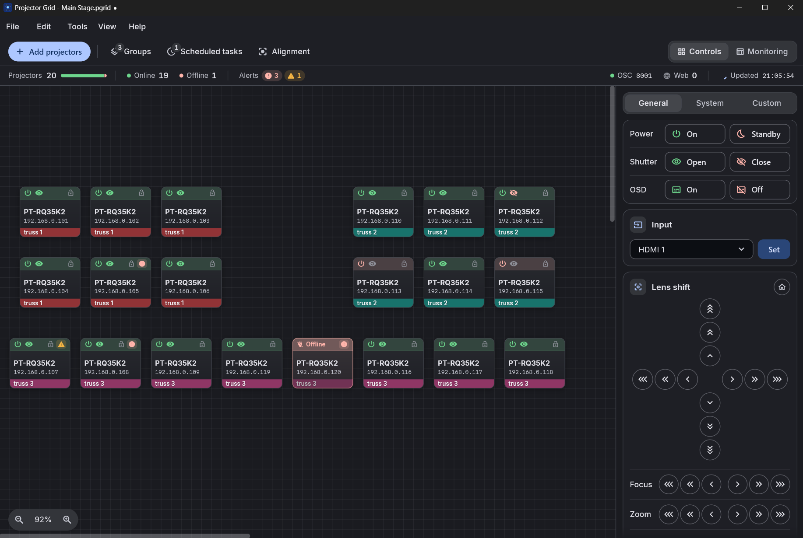

> **What's new in 2.0:** a full redesign, **telemetry alerts** with desktop notifications and sound, **Web Access** for phones and tablets, **Alignment mode**, **Edge Blending**, a new Monitoring view and daily log files. See the [changelog](CHANGELOG.md).

## 1. Set up the rig

Find the projectors, lay them out like the real wall and line up the image.

<table>
<tr>
<td width="50%" valign="top">
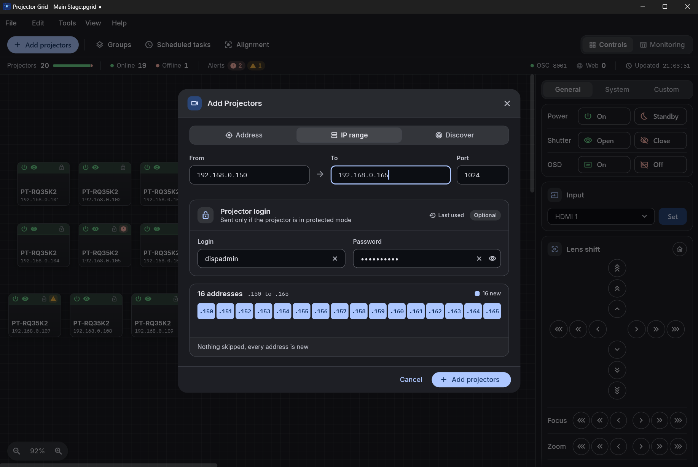
<h3>Discover and add</h3>
Scan the subnet or type an address or a whole range. Cards land on an infinite canvas you arrange like the real wall.
</td>
<td width="50%" valign="top">
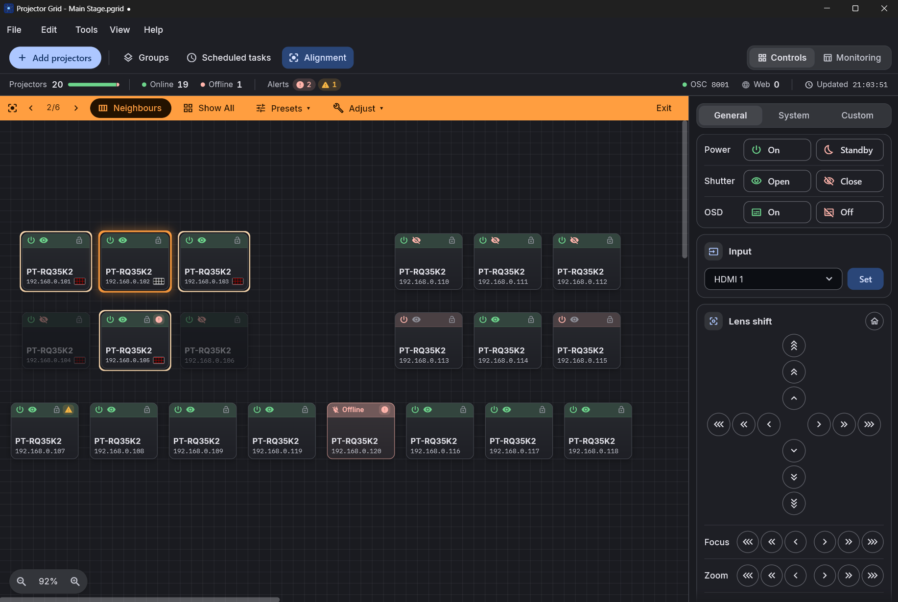
<h3>Alignment mode</h3>
Step through the wall one projector at a time. Leaving the mode puts every shutter and pattern back as it was.
</td>
</tr>
<tr>
<td width="50%" valign="top">
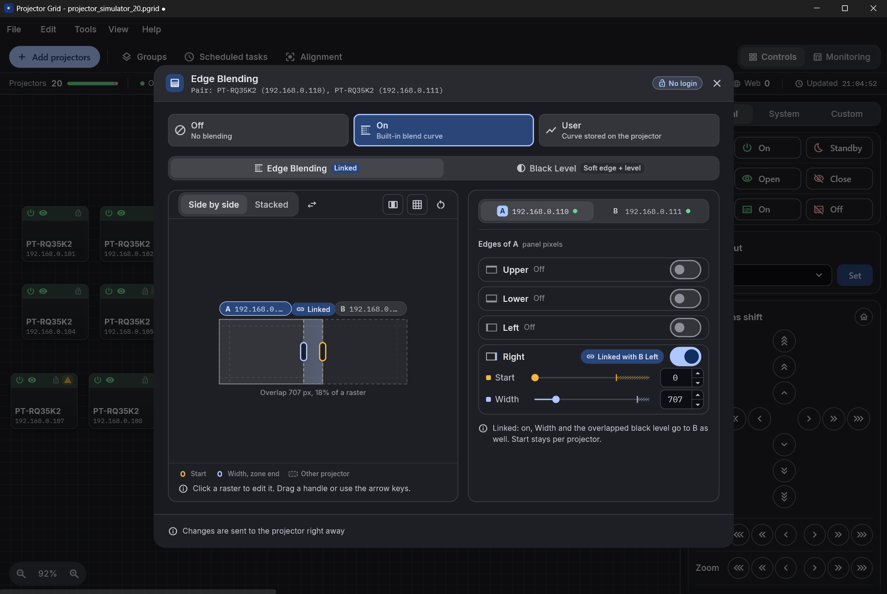
<h3>Edge Blending</h3>
Start and width per edge on a canvas with draggable zones. Open two projectors as a pair to see and link the overlap.
</td>
<td width="50%" valign="top">
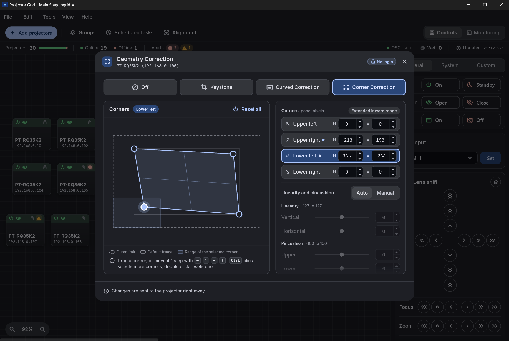
<h3>Geometry, brightness and colour</h3>
Keystone, curved and corner correction with a live preview, brightness modes in 0.1 % steps and colour matching.
</td>
</tr>
</table>

## 2. Run the show

Watch every projector at a glance and hear about a problem before the audience sees it.

<table>
<tr>
<td width="50%" valign="top">
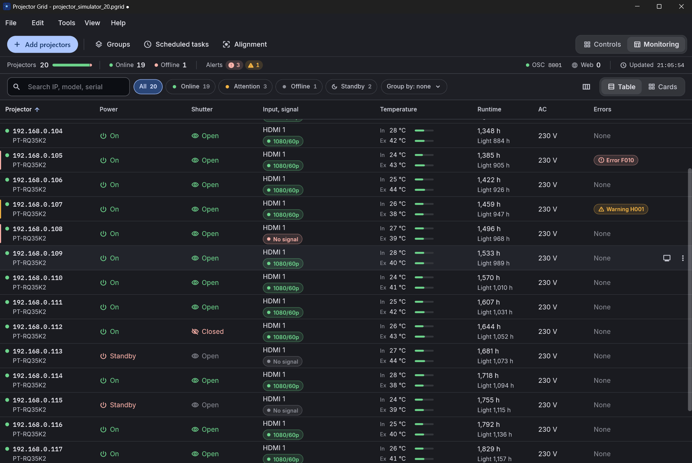
<h3>Monitoring</h3>
Power, shutter, input and signal, temperatures, runtime and errors for every projector, with search and quick filters.
</td>
<td width="50%" valign="top">
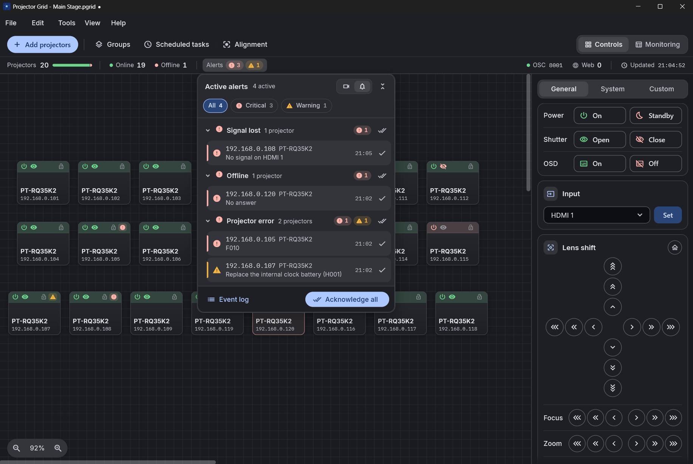
<h3>Telemetry alerts</h3>
Offline, projector errors decoded by name, signal lost and temperature. Desktop notifications, alert sounds and OSC.
</td>
</tr>
</table>

### Web Access

Any phone, tablet or laptop on the show network can watch and control the projectors in a browser, nothing to install. Viewer and Operator PINs, fully offline.

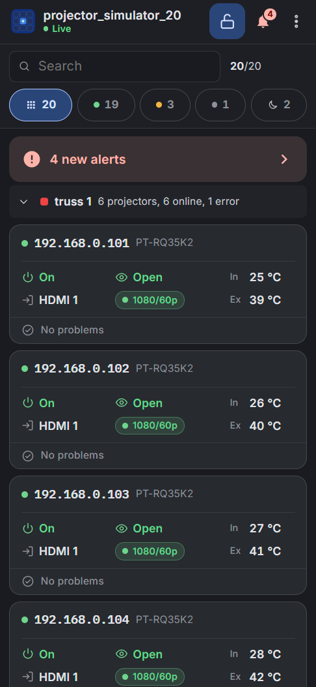
&nbsp;&nbsp;
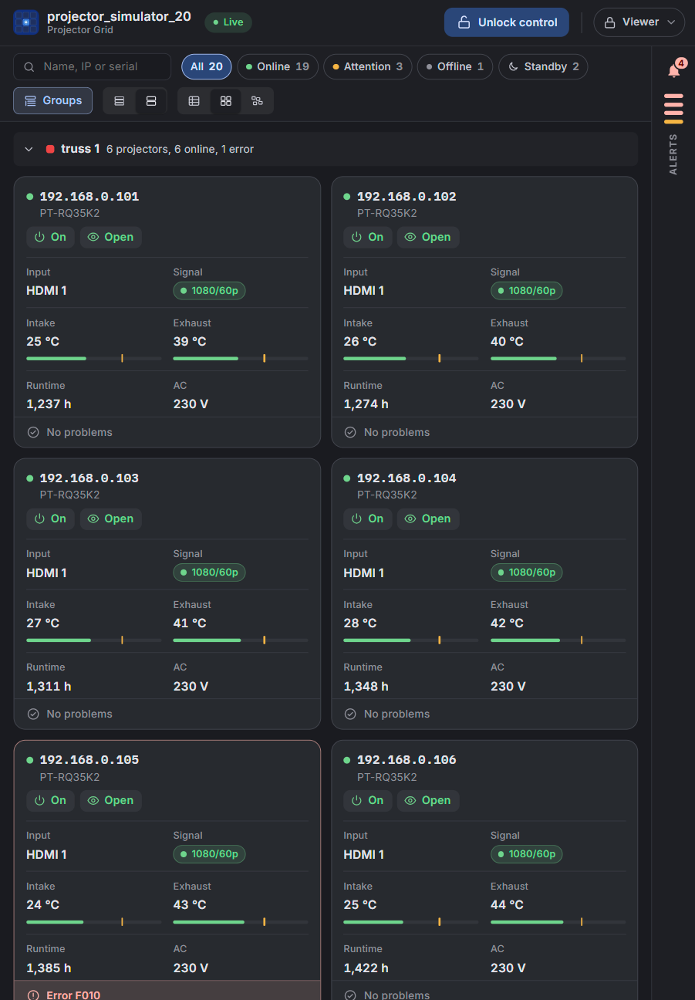

<table>
<tr>
<td width="50%" valign="top">
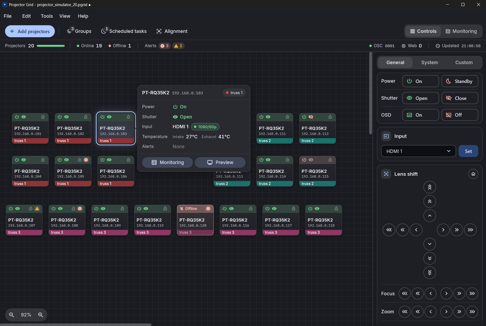
<h3>Quick status</h3>
Select a card and press Space for its power, shutter, input, signal, temperatures and alerts.
</td>
<td width="50%" valign="top">
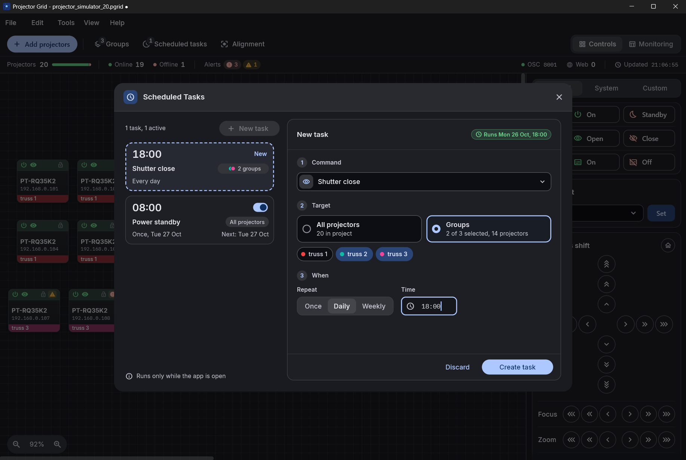
<h3>Scheduled tasks</h3>
Power, shutter or any command at a set time, daily, weekly or once, for all projectors or several groups.
</td>
</tr>
</table>

## Fits into your show control

Show controllers such as QLab, TouchDesigner or Resolume send commands over OSC and get live status back. Phones and tablets join through Web Access.

<picture>
  <source media="(prefers-color-scheme: dark)" srcset=".github/aux-images/show-control-dark.svg">
  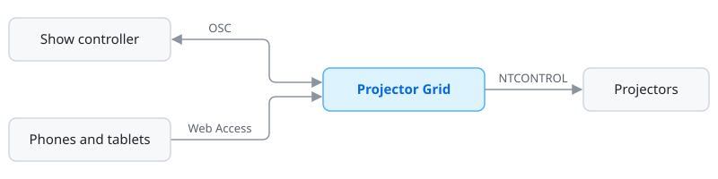
</picture>

Custom commands get their own OSC addresses, such as `/pgrid/all/custom/dynamic-contrast` or `/pgrid/group/stage/custom/dynamic-contrast`.

## 3. After the show

Find out what happened during the show.

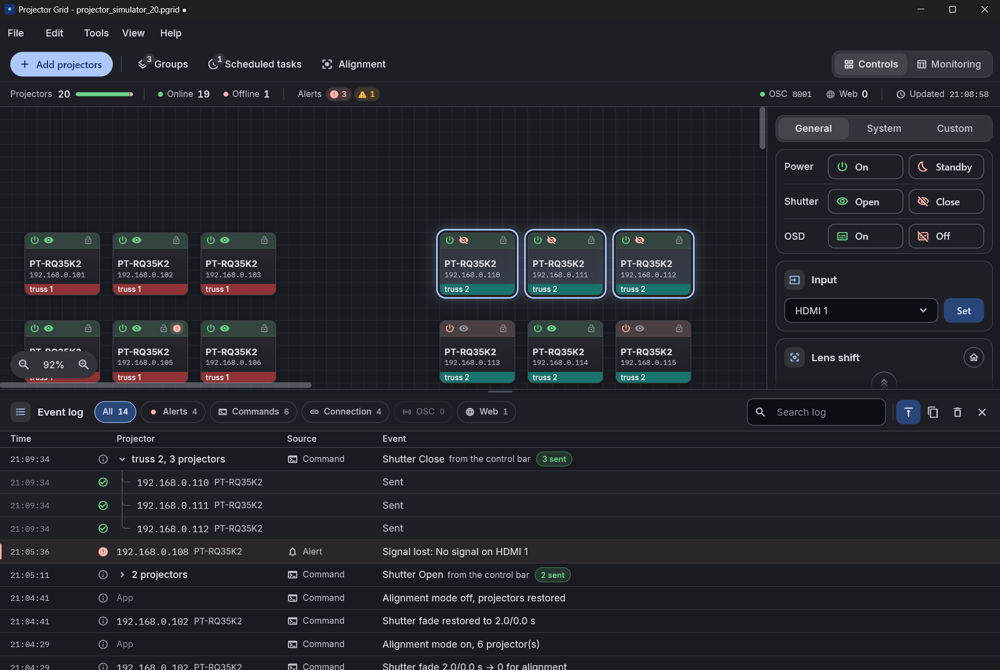

### Event log

Every command, alert and connection change. A command sent to many projectors is one row that opens to each result.

### Log files

Every Event log line is also written to a daily file, kept for 14 days and ready to attach to a bug report. Help, Open Logs Folder opens them.

## Supported projectors

Projector Grid talks to projectors over NTCONTROL, the control protocol built into most Panasonic projectors, so there is no list of models to check: if your projector can be controlled over the network, it works.

> **Tip:** a command doesn't work on your model? [Open an issue](https://github.com/zap-syr/projector-grid/issues/new) with the model and the command. Most commands are shared across Panasonic models, so these reports help everyone.

## Download

| Platform | Download | Requires |
|---|---|---|
| Windows | [Windows installer](https://github.com/zap-syr/projector-grid/releases/latest/download/ProjectorGrid_Setup.exe) | Windows 10 (64-bit) or later |
| macOS | [macOS disk image](https://github.com/zap-syr/projector-grid/releases/latest/download/ProjectorGrid-macOS.dmg) | macOS 12 or later, Intel and Apple Silicon |

## Contributing

Bug reports, model compatibility notes, feature ideas and code are all welcome. Please open an issue before a pull request. Project setup and building from source are in [DEVELOPMENT.md](DEVELOPMENT.md).

## License

GNU GPL v3. If Projector Grid saves you time on a show, you can [support it on Gumroad](https://projectorhub.gumroad.com/l/projectorgrid).
